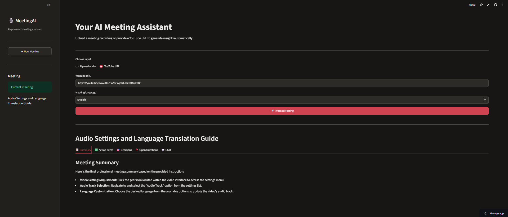
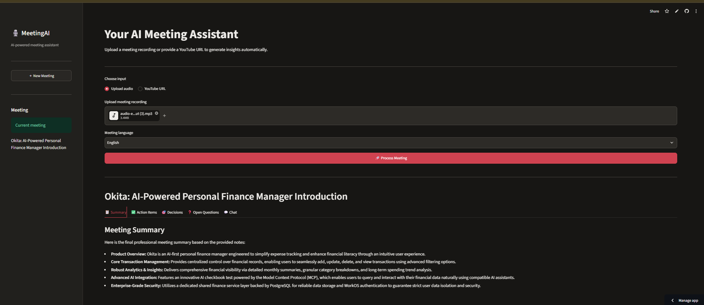
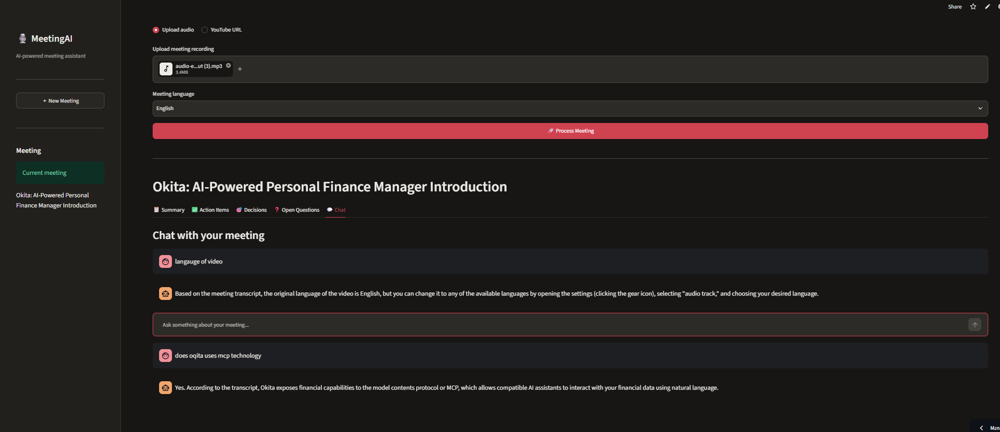
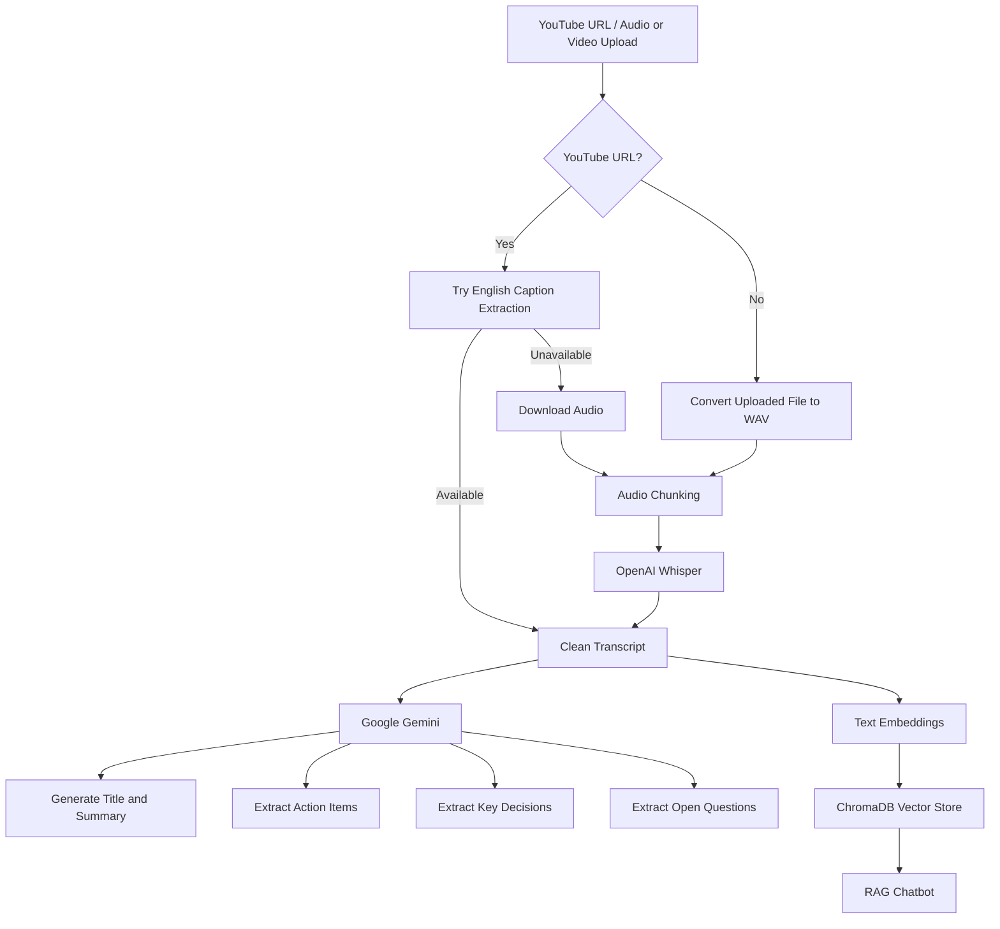

# 🎙️ AI Video Assistant — MeetingAI

An AI-powered meeting and video assistant that transforms audio recordings and YouTube videos into structured insights. It generates concise summaries, extracts action items and key decisions, identifies open questions, and lets users ask questions about the content through a Retrieval-Augmented Generation (RAG) chatbot.

**🚀 Live Demo:** [AI Video Assistant](https://oqita-aivideoassistant.streamlit.app/)

---

## 📸 Screenshots

<!-- Replace these sample image paths with your actual screenshots -->

### Application Interface


### AI-Generated Meeting Summary


### Chat with Your Meeting


---

## ✨ Features

- **YouTube Video Processing:** Paste a YouTube URL to extract its available English captions and process the transcript directly.
- **Audio & Video Upload:** Upload local recordings in supported formats such as WAV, MP3, M4A, MP4, and WEBM.
- **Automatic Speech Recognition:** Uses OpenAI Whisper to transcribe audio when a transcript is not available.
- **Hindi-to-English Transcription:** Supports Hindi audio input with Whisper's translation capability.
- **AI-Powered Summarization:** Generates concise, professional summaries using Google's Gemini model.
- **Automatic Title Generation:** Creates a meaningful title based on the transcript.
- **Action Item Extraction:** Identifies tasks, responsible owners, and deadlines when mentioned.
- **Key Decision Extraction:** Highlights important decisions made during the meeting.
- **Open Question Detection:** Identifies unresolved questions and topics requiring follow-up.
- **RAG-Based Chatbot:** Ask questions about the processed meeting and receive context-based answers.
- **Interactive Dashboard:** View summaries and extracted insights in a clean Streamlit interface.

---

## 🧠 How It Works

The application follows a multi-stage AI processing pipeline.



### Processing Pipeline

**1. Input Processing**

Users can provide either a YouTube URL or upload a local audio/video recording.

**2. Transcript Extraction**

For YouTube videos, the application first attempts to retrieve available English subtitles or automatic captions using `yt-dlp`.

If captions cannot be retrieved, the application attempts audio extraction and falls back to Whisper transcription.

For uploaded files, audio is converted into WAV format and divided into manageable chunks.

**3. Speech Recognition**

OpenAI Whisper processes the audio chunks and generates a transcript. Hindi audio can also be translated into English.

**4. Meeting Intelligence**

The transcript is passed to Google's Gemini model to generate:

- Meeting title
- Professional summary
- Action items
- Key decisions
- Open questions

**5. Retrieval-Augmented Generation (RAG)**

The transcript is split into smaller text chunks, converted into embeddings using Hugging Face sentence-transformer models, and stored in ChromaDB.

A retriever searches for relevant transcript sections when a user asks a question. Gemini then generates an answer using the retrieved context.

---

## 🛠️ Tech Stack

| Technology | Purpose |
|---|---|
| Python | Core application logic |
| Streamlit | Interactive web interface |
| OpenAI Whisper | Audio transcription and translation |
| Google Gemini | Summarization and information extraction |
| LangChain | LLM orchestration and RAG pipeline |
| Hugging Face | Text embeddings |
| ChromaDB | Vector database |
| yt-dlp | YouTube metadata, captions, and audio extraction |
| Pydub | Audio conversion and processing |
| FFmpeg | Audio/video processing |

---

## 📂 Project Structure

```text
AiVideoAssistant/
│
├── app.py                      # Streamlit application
├── main.py                     # Main processing pipeline
│
├── core/
│   ├── llm.py                  # Gemini model configuration
│   ├── transcriber.py          # Whisper transcription
│   ├── summarize.py            # Title generation and summarization
│   ├── extractor.py            # Action items, decisions, questions
│   ├── rag_engine.py           # RAG chain and question answering
│   └── vector_store.py         # Embeddings and ChromaDB
│
├── utils/
│   └── audio_processor.py      # YouTube captions, audio conversion,
│                               # and audio chunking
│
├── assets/
│   └── screenshots/
│       ├── home.png
│       ├── summary.png
│       ├── insights.png
│       └── chat.png
│
├── downloads/                  # Downloaded audio files
│
├── .env                        # Local environment variables
├── requirements.txt            # Python dependencies
├── packages.txt                # System packages for deployment
└── README.md
```

---

## ⚙️ Installation and Setup

### Prerequisites

- Python 3.12 recommended
- Git
- FFmpeg
- A Google Gemini API key

### 1. Clone the Repository

```bash
git clone https://github.com/Ashish96300/AiVideoAssistant.git
```

```bash
cd AiVideoAssistant
```

### 2. Create a Virtual Environment

```bash
python -m venv .venv
```

Activate it:

**Windows:**
```bash
.venv\Scripts\activate
```

**Linux / macOS:**
```bash
source .venv/bin/activate
```

### 3. Install Dependencies

```bash
pip install -r requirements.txt
```

Make sure FFmpeg is installed and available in your system PATH.

### 4. Configure Environment Variables

Create a `.env` file in the project root:

```env
GEMINI_API_KEY=your_gemini_api_key
WHISPER_MODEL=base
```

Get your Gemini API key from [Google AI Studio](https://aistudio.google.com/apikey).

**Important:** Never commit your `.env` file or expose your API key publicly.

### 5. Run the Application

```bash
streamlit run app.py
```

The application will open in your browser.

---

## ☁️ Deployment

The application is deployed using **Streamlit Community Cloud**.

Live application:

[https://oqita-aivideoassistant.streamlit.app/](https://oqita-aivideoassistant.streamlit.app/)

To deploy your own instance:

1. Push the project to a GitHub repository.
2. Open [Streamlit Community Cloud](https://share.streamlit.io/).
3. Connect your GitHub repository.
4. Select `app.py` as the application entry point.
5. Add your `GEMINI_API_KEY` under the application's Secrets settings.
6. Deploy the application.

The repository includes `packages.txt` for system-level dependencies such as FFmpeg.

---

## ⚠️ Current Limitations

- YouTube transcript-first processing currently supports English captions.
- Videos without accessible English captions require the audio extraction and Whisper fallback.
- YouTube may restrict audio downloads in some cloud-hosted environments, which can cause HTTP 403 errors.
- Hindi YouTube videos currently rely on the audio and Whisper fallback rather than the English caption-first path.
- Transcription and embedding generation can take time depending on recording duration and available resources.
- RAG answers depend on the transcript content and retrieved context, so exact-word or positional questions may not always be answered accurately.

---

## 🔮 Future Improvements

- Support for additional subtitle languages.
- Improved transcript retrieval and exact-text question answering.
- Speaker identification and diarization.
- Export meeting summaries as PDF or DOCX.
- Better processing feedback for long recordings.
- Persistent meeting history and transcript management.

---

## 👨‍💻 Author

**Ashish Sen**

B.Tech — Information Technology

GitHub: [@Ashish96300](https://github.com/Ashish96300)

---

## 📄 License

This project is intended for learning, experimentation, and demonstration purposes. Add an appropriate open-source license if you plan to distribute or reuse the project publicly.